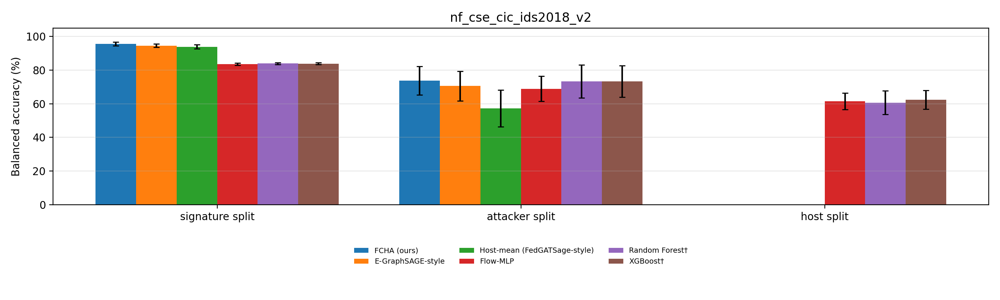
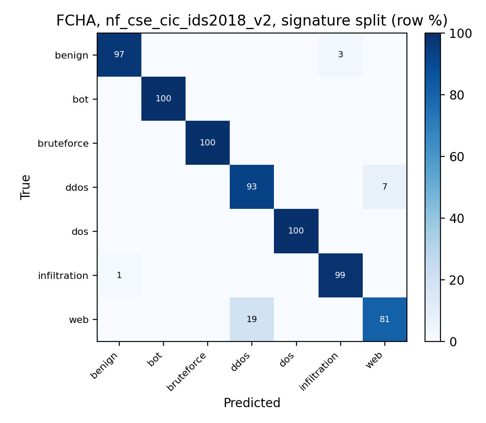
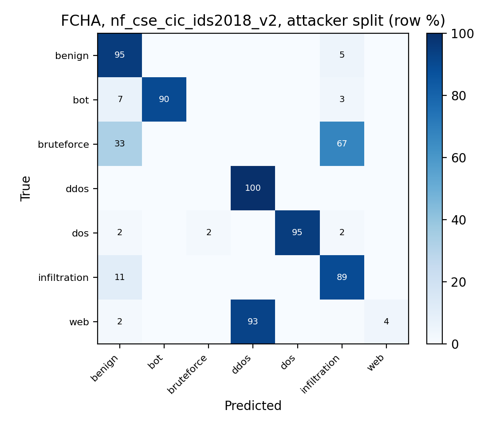
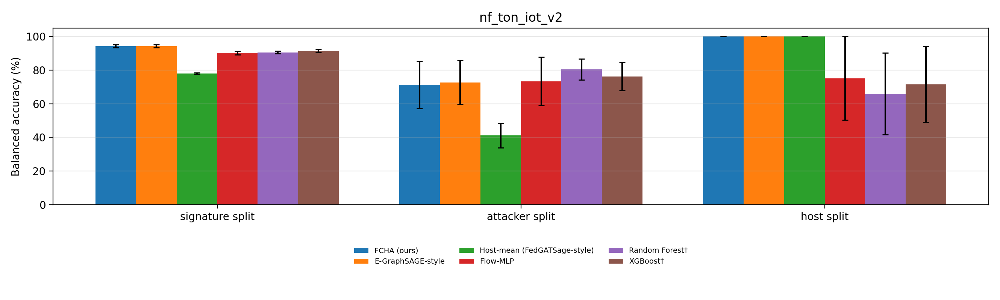
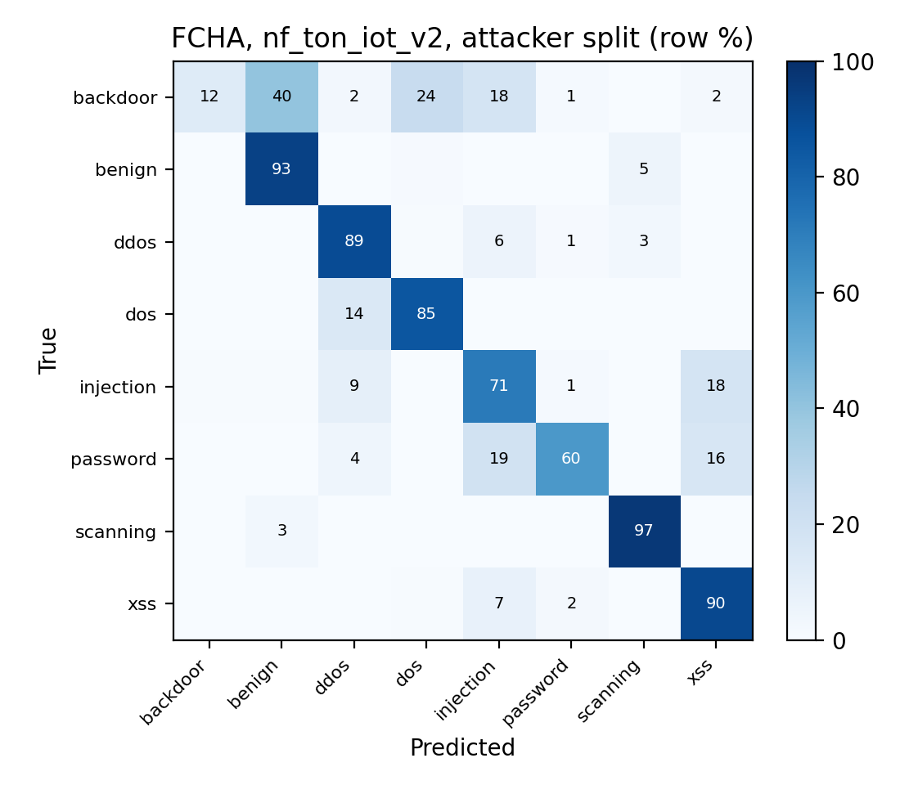
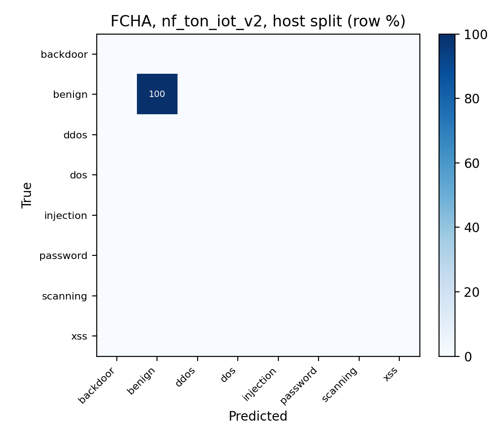
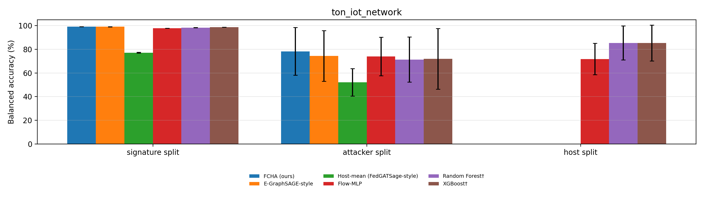
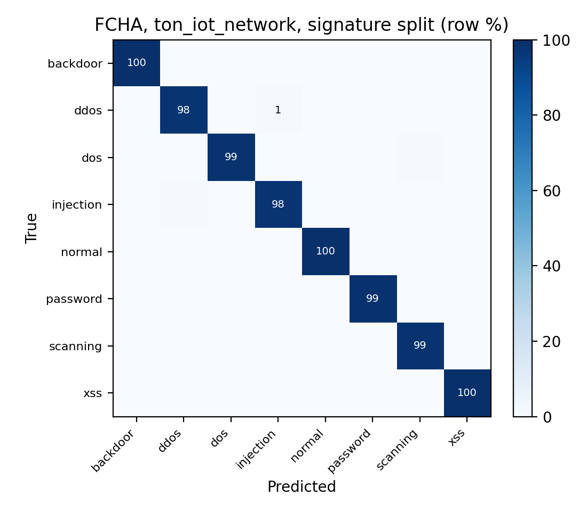
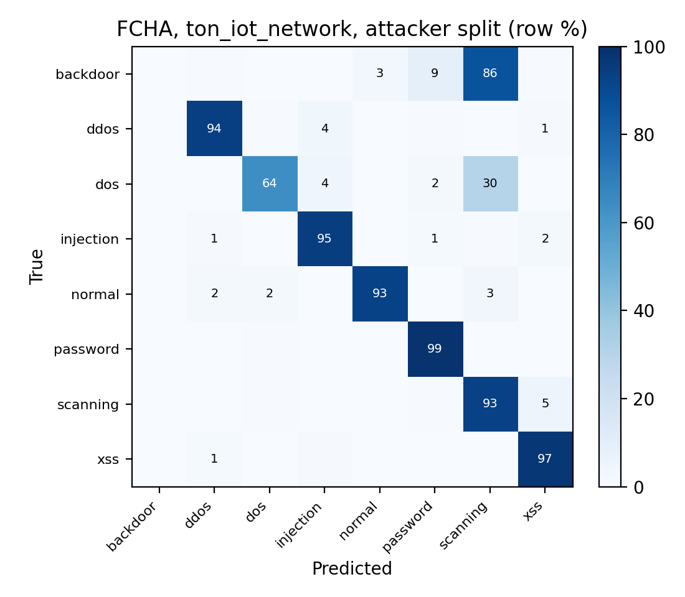

# FedFlow paper results

Mean ± sample SD over folds × seeds. † = centralised (sees pooled data); all others are federated (5 clients). p-values: paired Wilcoxon signed-rank vs FCHA over matched (fold, seed), Holm-corrected.

## NF-CSE-CIC-IDS2018-v2

### T1 — main results, signature split, IID clients

| Model | runs | Accuracy | Balanced acc. | Macro-F1 | FPR | p vs FCHA (Holm) |
|---|---|---|---|---|---|---|
| FCHA (ours) | 15 | 98.1 ± 0.1 | 95.6 ± 1.1 | 90.2 ± 0.4 | 2.9 ± 0.2 | — |
| E-GraphSAGE-style | 15 | 98.1 ± 0.2 | 94.5 ± 1.1 | 90.2 ± 0.4 | 3.1 ± 0.4 | <0.001 |
| Host-mean (FedGATSage-style) | 15 | 97.7 ± 0.2 | 93.9 ± 1.2 | 89.4 ± 0.4 | 4.8 ± 0.6 | <0.001 |
| Flow-MLP | 15 | 94.3 ± 0.3 | 83.5 ± 0.6 | 85.2 ± 0.6 | 11.1 ± 2.8 | <0.001 |
| Random Forest† | 15 | 94.2 ± 0.3 | 83.9 ± 0.6 | 83.8 ± 0.5 | 10.4 ± 0.7 | <0.001 |
| XGBoost† | 15 | 94.9 ± 0.3 | 83.9 ± 0.5 | 86.1 ± 0.6 | 6.5 ± 0.4 | <0.001 |

### T1 — main results, attacker split, IID clients

| Model | runs | Accuracy | Balanced acc. | Macro-F1 | FPR | p vs FCHA (Holm) |
|---|---|---|---|---|---|---|
| FCHA (ours) | 15 | 83.5 ± 19.0 | 73.8 ± 8.5 | 71.1 ± 8.8 | 4.9 ± 2.4 | — |
| E-GraphSAGE-style | 15 | 80.0 ± 21.4 | 70.5 ± 8.8 | 66.5 ± 13.0 | 5.0 ± 3.0 | 0.321 |
| Host-mean (FedGATSage-style) | 15 | 76.6 ± 25.3 | 57.2 ± 10.9 | 52.3 ± 15.1 | 6.4 ± 4.4 | <0.001 |
| Flow-MLP | 15 | 75.8 ± 19.0 | 68.8 ± 7.5 | 63.3 ± 11.8 | 13.8 ± 6.2 | 0.017 |
| Random Forest† | 15 | 81.6 ± 21.0 | 73.3 ± 9.7 | 70.4 ± 11.3 | 10.8 ± 1.1 | 0.338 |
| XGBoost† | 15 | 74.2 ± 20.6 | 73.3 ± 9.4 | 65.5 ± 17.7 | 6.3 ± 1.8 | 0.762 |

### T1 — main results, host split, IID clients

| Model | runs | Accuracy | Balanced acc. | Macro-F1 | FPR | p vs FCHA (Holm) |
|---|---|---|---|---|---|---|
| Flow-MLP | 15 | 85.9 ± 6.9 | 61.5 ± 4.9 | 59.2 ± 6.2 | 13.6 ± 5.5 | — |
| Random Forest† | 15 | 83.8 ± 12.4 | 60.6 ± 7.0 | 59.2 ± 8.2 | 11.2 ± 3.1 | — |
| XGBoost† | 15 | 89.2 ± 5.0 | 62.4 ± 5.6 | 60.6 ± 5.7 | 5.8 ± 1.9 | — |

### T2 — client heterogeneity (signature split)

| Model | Partition | Balanced acc. | Macro-F1 |
|---|---|---|---|
| FCHA (ours) | dirichlet_a0.5 | 93.6 ± 2.4 | 89.9 ± 0.7 |
| FCHA (ours) | iid | 95.6 ± 1.1 | 90.2 ± 0.4 |
| Flow-MLP | dirichlet_a0.5 | 83.0 ± 0.8 | 84.4 ± 1.1 |
| Flow-MLP | iid | 83.5 ± 0.6 | 85.2 ± 0.6 |

### T3 — ablation (signature split)

| Model | runs | Accuracy | Balanced acc. | Macro-F1 | FPR | p vs FCHA (Holm) |
|---|---|---|---|---|---|---|
| FCHA (ours) | 15 | 98.1 ± 0.1 | 95.6 ± 1.1 | 90.2 ± 0.4 | 2.9 ± 0.2 | — |
| FCHA + SupCon | 15 | 98.1 ± 0.1 | 95.6 ± 1.1 | 90.2 ± 0.4 | 2.9 ± 0.3 | 0.679 |
| FCHA, centralised† | 15 | 98.1 ± 0.1 | 95.6 ± 1.1 | 90.2 ± 0.5 | 2.8 ± 0.4 | 0.303 |
| E-GraphSAGE-style | 15 | 98.1 ± 0.2 | 94.5 ± 1.1 | 90.2 ± 0.4 | 3.1 ± 0.4 | <0.001 |
| Host-mean (FedGATSage-style) | 15 | 97.7 ± 0.2 | 93.9 ± 1.2 | 89.4 ± 0.4 | 4.8 ± 0.6 | <0.001 |
| Flow-MLP | 15 | 94.3 ± 0.3 | 83.5 ± 0.6 | 85.2 ± 0.6 | 11.1 ± 2.8 | <0.001 |

### T4 — per-class recall (%), signature split

| Class | FCHA (ours) | Flow-MLP | Random Forest† | XGBoost† |
|---|---|---|---|---|
| benign | 97.1 | 88.9 | 89.6 | 93.5 |
| bot | 100.0 | 99.1 | 99.1 | 100.0 |
| bruteforce | 100.0 | 100.0 | 99.9 | 99.9 |
| ddos | 92.8 | 99.9 | 97.1 | 99.9 |
| dos | 99.9 | 99.9 | 100.0 | 100.0 |
| infiltration | 98.6 | 68.0 | 69.9 | 66.0 |
| web | 80.4 | 28.6 | 31.4 | 27.6 |

### T5 — attention lift on mixed hosts (FCHA)

| Split | benign | bot | bruteforce | ddos | dos | infiltration | web |
|---|---|---|---|---|---|---|---|
| signature | 0.97 | 1.37 | 0.54 | 0.96 | 1.02 | 0.99 | 1.58 |
| attacker | 0.97 | 2.03 | 1.42 | 1.56 | 1.24 | 0.97 | 0.89 |

### T6 — duplicate capping (≤10 copies per identical flow)

| Class | Before | After |
|---|---|---|
| benign | 150000 | 46392 |
| bot | 143097 | 997 |
| bruteforce | 120912 | 16924 |
| ddos | 150000 | 45904 |
| dos | 150000 | 139131 |
| infiltration | 116361 | 29764 |
| web | 3502 | 1520 |

## NF-ToN-IoT-v2

### T1 — main results, signature split, IID clients

| Model | runs | Accuracy | Balanced acc. | Macro-F1 | FPR | p vs FCHA (Holm) |
|---|---|---|---|---|---|---|
| FCHA (ours) | 15 | 94.4 ± 0.1 | 94.2 ± 0.9 | 92.2 ± 1.5 | 4.6 ± 0.3 | — |
| E-GraphSAGE-style | 15 | 94.4 ± 0.1 | 94.1 ± 0.9 | 92.0 ± 1.7 | 4.5 ± 0.4 | 0.095 |
| Host-mean (FedGATSage-style) | 15 | 77.5 ± 0.2 | 78.0 ± 0.5 | 74.9 ± 1.5 | 31.0 ± 1.0 | <0.001 |
| Flow-MLP | 15 | 91.4 ± 0.1 | 90.1 ± 0.9 | 87.2 ± 2.2 | 6.7 ± 0.8 | <0.001 |
| Random Forest† | 15 | 92.6 ± 0.2 | 90.5 ± 0.8 | 91.1 ± 0.8 | 3.5 ± 0.3 | <0.001 |
| XGBoost† | 15 | 93.2 ± 0.1 | 91.4 ± 0.9 | 91.7 ± 0.8 | 4.8 ± 0.4 | <0.001 |

### T1 — main results, attacker split, IID clients

| Model | runs | Accuracy | Balanced acc. | Macro-F1 | FPR | p vs FCHA (Holm) |
|---|---|---|---|---|---|---|
| FCHA (ours) | 15 | 84.0 ± 9.0 | 71.4 ± 14.1 | 72.5 ± 16.0 | 11.8 ± 9.3 | — |
| E-GraphSAGE-style | 15 | 82.5 ± 12.0 | 72.7 ± 13.1 | 73.9 ± 14.3 | 19.1 ± 17.7 | 0.757 |
| Host-mean (FedGATSage-style) | 15 | 57.7 ± 6.7 | 41.1 ± 7.3 | 39.7 ± 8.4 | 64.2 ± 15.7 | <0.001 |
| Flow-MLP | 15 | 81.7 ± 9.2 | 73.4 ± 14.3 | 70.9 ± 17.6 | 16.3 ± 14.5 | 0.757 |
| Random Forest† | 15 | 85.2 ± 2.5 | 80.3 ± 6.2 | 77.8 ± 7.7 | 10.5 ± 12.1 | 0.041 |
| XGBoost† | 15 | 81.4 ± 8.6 | 76.2 ± 8.4 | 70.5 ± 15.0 | 12.1 ± 12.8 | 0.757 |

### T1 — main results, host split, IID clients

| Model | runs | Accuracy | Balanced acc. | Macro-F1 | FPR | p vs FCHA (Holm) |
|---|---|---|---|---|---|---|
| FCHA (ours) | 3 | 100.0 ± 0.0 | 100.0 ± 0.0 | 100.0 ± 0.0 | 0.0 ± 0.0 | — |
| E-GraphSAGE-style | 3 | 100.0 ± 0.0 | 100.0 ± 0.0 | 100.0 ± 0.0 | 0.0 ± 0.0 | — |
| Host-mean (FedGATSage-style) | 3 | 100.0 ± 0.0 | 100.0 ± 0.0 | 100.0 ± 0.0 | 0.0 ± 0.0 | — |
| Flow-MLP | 15 | 86.8 ± 20.7 | 75.1 ± 24.9 | 73.3 ± 29.3 | 6.7 ± 8.3 | — |
| Random Forest† | 15 | 76.8 ± 24.7 | 66.0 ± 24.3 | 67.4 ± 26.6 | 19.2 ± 22.7 | — |
| XGBoost† | 15 | 82.4 ± 20.2 | 71.5 ± 22.5 | 71.2 ± 27.8 | 10.4 ± 10.7 | — |

### T2 — client heterogeneity (signature split)

| Model | Partition | Balanced acc. | Macro-F1 |
|---|---|---|---|
| FCHA (ours) | dirichlet_a0.5 | 93.1 ± 0.9 | 91.6 ± 1.6 |
| FCHA (ours) | iid | 94.2 ± 0.9 | 92.2 ± 1.5 |
| Flow-MLP | dirichlet_a0.5 | 89.6 ± 1.3 | 87.2 ± 1.6 |
| Flow-MLP | iid | 90.1 ± 0.9 | 87.2 ± 2.2 |

### T3 — ablation (signature split)

| Model | runs | Accuracy | Balanced acc. | Macro-F1 | FPR | p vs FCHA (Holm) |
|---|---|---|---|---|---|---|
| FCHA (ours) | 15 | 94.4 ± 0.1 | 94.2 ± 0.9 | 92.2 ± 1.5 | 4.6 ± 0.3 | — |
| FCHA + SupCon | 15 | 94.4 ± 0.1 | 94.0 ± 0.9 | 91.9 ± 1.6 | 4.5 ± 0.5 | 0.284 |
| FCHA, centralised† | 15 | 94.6 ± 0.2 | 94.5 ± 0.8 | 91.9 ± 1.9 | 4.6 ± 1.2 | 0.303 |
| E-GraphSAGE-style | 15 | 94.4 ± 0.1 | 94.1 ± 0.9 | 92.0 ± 1.7 | 4.5 ± 0.4 | 0.284 |
| Host-mean (FedGATSage-style) | 15 | 77.5 ± 0.2 | 78.0 ± 0.5 | 74.9 ± 1.5 | 31.0 ± 1.0 | <0.001 |
| Flow-MLP | 15 | 91.4 ± 0.1 | 90.1 ± 0.9 | 87.2 ± 2.2 | 6.7 ± 0.8 | <0.001 |

### T4 — per-class recall (%), signature split

| Class | FCHA (ours) | Flow-MLP | Random Forest† | XGBoost† |
|---|---|---|---|---|
| backdoor | 92.8 | 81.2 | 77.3 | 80.0 |
| benign | 95.4 | 93.3 | 96.5 | 95.2 |
| ddos | 96.8 | 95.5 | 95.2 | 96.0 |
| dos | 99.8 | 98.4 | 98.0 | 98.6 |
| injection | 86.7 | 77.0 | 84.8 | 85.0 |
| password | 89.5 | 87.4 | 84.7 | 87.6 |
| scanning | 98.8 | 98.4 | 98.7 | 98.8 |
| xss | 93.9 | 89.7 | 88.4 | 89.8 |

### T5 — attention lift on mixed hosts (FCHA)

| Split | backdoor | benign | ddos | dos | injection | password | scanning | xss |
|---|---|---|---|---|---|---|---|---|
| signature | 0.99 | 0.90 | 1.28 | 1.89 | 1.07 | 1.08 | 1.18 | 0.79 |
| attacker | 1.15 | 1.03 | 1.23 | 0.90 | 1.13 | 0.84 | 0.99 | 0.91 |
| host | — | — | — | — | — | — | — | — |

### T6 — duplicate capping (≤10 copies per identical flow)

| Class | Before | After |
|---|---|---|
| backdoor | 16809 | 239 |
| benign | 150000 | 45148 |
| ddos | 150000 | 43422 |
| dos | 150000 | 23067 |
| injection | 150000 | 63514 |
| password | 150000 | 52878 |
| scanning | 150000 | 115309 |
| xss | 150000 | 52974 |

## ToN-IoT-Network

### T1 — main results, signature split, IID clients

| Model | runs | Accuracy | Balanced acc. | Macro-F1 | FPR | p vs FCHA (Holm) |
|---|---|---|---|---|---|---|
| FCHA (ours) | 15 | 99.0 ± 0.1 | 99.1 ± 0.1 | 99.1 ± 0.1 | 0.1 ± 0.1 | — |
| E-GraphSAGE-style | 15 | 99.0 ± 0.1 | 99.1 ± 0.1 | 99.0 ± 0.1 | 0.1 ± 0.1 | 0.008 |
| Host-mean (FedGATSage-style) | 15 | 74.5 ± 0.4 | 77.2 ± 0.4 | 76.9 ± 0.4 | 0.2 ± 0.1 | <0.001 |
| Flow-MLP | 15 | 97.7 ± 0.1 | 97.8 ± 0.1 | 97.4 ± 0.1 | 0.7 ± 0.1 | <0.001 |
| Random Forest† | 15 | 98.5 ± 0.1 | 98.3 ± 0.1 | 98.3 ± 0.1 | 0.3 ± 0.1 | <0.001 |
| XGBoost† | 15 | 98.7 ± 0.1 | 98.6 ± 0.1 | 98.6 ± 0.1 | 0.4 ± 0.1 | <0.001 |

### T1 — main results, attacker split, IID clients

| Model | runs | Accuracy | Balanced acc. | Macro-F1 | FPR | p vs FCHA (Holm) |
|---|---|---|---|---|---|---|
| FCHA (ours) | 15 | 82.8 ± 20.9 | 78.3 ± 20.2 | 78.6 ± 19.5 | 6.0 ± 9.1 | — |
| E-GraphSAGE-style | 15 | 77.4 ± 22.6 | 74.5 ± 21.4 | 74.9 ± 18.9 | 11.2 ± 18.2 | 0.428 |
| Host-mean (FedGATSage-style) | 15 | 57.7 ± 22.7 | 52.0 ± 11.6 | 54.4 ± 12.3 | 20.1 ± 25.7 | <0.001 |
| Flow-MLP | 15 | 75.7 ± 15.8 | 74.0 ± 16.2 | 72.1 ± 17.3 | 17.0 ± 26.1 | 0.428 |
| Random Forest† | 15 | 73.1 ± 20.7 | 71.4 ± 19.0 | 71.1 ± 17.1 | 16.5 ± 25.5 | 0.428 |
| XGBoost† | 15 | 76.1 ± 26.4 | 71.9 ± 25.6 | 74.4 ± 22.5 | 22.1 ± 26.5 | 0.428 |

### T1 — main results, host split, IID clients

| Model | runs | Accuracy | Balanced acc. | Macro-F1 | FPR | p vs FCHA (Holm) |
|---|---|---|---|---|---|---|
| Flow-MLP | 15 | 91.6 ± 7.2 | 71.8 ± 13.3 | 70.2 ± 9.7 | 12.9 ± 17.8 | — |
| Random Forest† | 15 | 87.3 ± 15.9 | 85.3 ± 14.3 | 79.5 ± 20.9 | 7.0 ± 11.1 | — |
| XGBoost† | 15 | 87.4 ± 16.7 | 85.3 ± 15.1 | 80.0 ± 21.0 | 12.1 ± 23.2 | — |

### T2 — client heterogeneity (signature split)

| Model | Partition | Balanced acc. | Macro-F1 |
|---|---|---|---|
| FCHA (ours) | dirichlet_a0.5 | 99.0 ± 0.2 | 98.9 ± 0.1 |
| FCHA (ours) | iid | 99.1 ± 0.1 | 99.1 ± 0.1 |
| Flow-MLP | dirichlet_a0.5 | 97.6 ± 0.2 | 97.2 ± 0.2 |
| Flow-MLP | iid | 97.8 ± 0.1 | 97.4 ± 0.1 |

### T3 — ablation (signature split)

| Model | runs | Accuracy | Balanced acc. | Macro-F1 | FPR | p vs FCHA (Holm) |
|---|---|---|---|---|---|---|
| FCHA (ours) | 15 | 99.0 ± 0.1 | 99.1 ± 0.1 | 99.1 ± 0.1 | 0.1 ± 0.1 | — |
| FCHA + SupCon | 15 | 99.0 ± 0.1 | 99.1 ± 0.1 | 99.1 ± 0.1 | 0.1 ± 0.1 | 0.934 |
| FCHA, centralised† | 15 | 99.2 ± 0.1 | 99.2 ± 0.1 | 99.2 ± 0.1 | 0.1 ± 0.1 | <0.001 |
| E-GraphSAGE-style | 15 | 99.0 ± 0.1 | 99.1 ± 0.1 | 99.0 ± 0.1 | 0.1 ± 0.1 | 0.017 |
| Host-mean (FedGATSage-style) | 15 | 74.5 ± 0.4 | 77.2 ± 0.4 | 76.9 ± 0.4 | 0.2 ± 0.1 | <0.001 |
| Flow-MLP | 15 | 97.7 ± 0.1 | 97.8 ± 0.1 | 97.4 ± 0.1 | 0.7 ± 0.1 | <0.001 |

### T4 — per-class recall (%), signature split

| Class | FCHA (ours) | Flow-MLP | Random Forest† | XGBoost† |
|---|---|---|---|---|
| backdoor | 100.0 | 99.8 | 99.9 | 99.9 |
| ddos | 98.3 | 96.2 | 98.3 | 98.5 |
| dos | 98.6 | 97.7 | 98.8 | 98.7 |
| injection | 98.4 | 94.8 | 97.2 | 97.3 |
| normal | 99.9 | 99.3 | 99.7 | 99.6 |
| password | 99.0 | 98.7 | 99.3 | 99.4 |
| scanning | 98.6 | 98.2 | 98.1 | 98.8 |
| xss | 100.0 | 97.6 | 95.0 | 97.0 |

### T5 — attention lift on mixed hosts (FCHA)

| Split | backdoor | ddos | dos | injection | normal | password | scanning | xss |
|---|---|---|---|---|---|---|---|---|
| signature | 0.56 | 0.75 | 1.66 | 0.83 | 0.91 | 1.34 | 1.00 | 0.94 |
| attacker | 0.75 | 0.89 | 0.69 | 1.00 | 1.89 | 1.36 | 0.66 | 1.10 |

### T6 — duplicate capping (≤10 copies per identical flow)

| Class | Before | After |
|---|---|---|
| backdoor | 20000 | 6960 |
| ddos | 20000 | 16862 |
| dos | 20000 | 19874 |
| injection | 20000 | 19894 |
| normal | 50000 | 27341 |
| password | 20000 | 17733 |
| scanning | 20000 | 12772 |
| xss | 20000 | 8812 |

